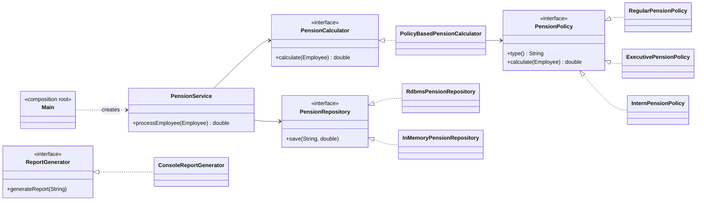

# 01 · SOLID — Refactoring PensionService

Assignment: refactor a "bad" pension calculation class so that it follows the **SOLID** principles.

## Before

One class did everything: calculated the pension, saved the result and printed a report.

```java
public class PensionService {
    public void processEmployee(String name, int age, double salary, String type) {
        if (type.equals("REGULAR"))   { /* 5%  → print → save */ }
        if (type.equals("EXECUTIVE")) { /* 10% + 1000 → print → save */ }
    }
    public void saveToDatabase(String name, double pension) { ... }
    public void generateReport(String name) { ... }
}
```

## After



```
src/main/java/mypackage
├── Main.java                         ← wires the app together (the only place using new)
├── model/Employee.java               ← employee data
├── calculation/
│   ├── PensionCalculator.java        ← interface: "can calculate"
│   ├── PolicyBasedPensionCalculator  ← picks the policy by employee type
│   ├── PensionPolicy.java            ← policy interface + contract
│   ├── RegularPensionPolicy          ← 5%
│   ├── ExecutivePensionPolicy        ← 10% + 1000
│   └── InternPensionPolicy           ← 2% (added to demonstrate OCP)
├── persistence/
│   ├── PensionRepository.java        ← interface: "can save"
│   ├── RdbmsPensionRepository        ← saves to a database
│   └── InMemoryPensionRepository     ← saves in memory
├── reporting/
│   ├── ReportGenerator.java          ← interface: "can generate a report"
│   └── ConsoleReportGenerator
└── service/PensionService.java       ← coordinates calculation and saving
```

## Principles by task

### Task 1 · SRP and ISP

| | Problem | Solution | Verification |
|---|---|---|---|
| **S** — Single Responsibility | Three different jobs in one class | A separate class for each job: calculation, persistence, reporting, coordination | Changed the report text — calculation and saving were unaffected |
| **I** — Interface Segregation | A client that only needed reports depended on the whole class | Small single-method interfaces: `PensionCalculator`, `PensionRepository`, `ReportGenerator` | `PensionRepository` has only `save` |

### Task 2 · OCP and LSP

| | Problem | Solution | Verification |
|---|---|---|---|
| **O** — Open/Closed | A new employee type meant a new `if` in working code | A `PensionPolicy` interface with one class per type | Added `InternPensionPolicy` (2%) without touching existing classes: 430,000 × 2% = 8,600 |
| **L** — Liskov Substitution | The calculator calls any policy blindly | Contract: pension ≥ 0, no exceptions on valid input, no side effects. `Executive` does not inherit from `Regular` | Without `implements` the code does not compile; a wrong formula still compiles — tests catch it |

### Task 3 · DIP

| | Problem | Solution | Verification |
|---|---|---|---|
| **D** — Dependency Inversion | The service was hard-wired to the database | `PensionService` depends only on interfaces, injected via the constructor; `new` is used only in `Main` | Swapped `RdbmsPensionRepository` for `InMemoryPensionRepository` with one line in `Main`; the service was unchanged |

### Task 4 · Additional considerations

**Done**
- `Employee` validates its input (blank name, negative salary)
- Unknown employee type → a clear error instead of silently doing nothing
- Tests: the `PensionPolicy` contract for every policy, calculations, the service with substituted dependencies

**Possible improvements**
- `BigDecimal` instead of `double` for money
- An `enum` instead of strings for the employee type
- A logger instead of `System.out.println`

## Running

- **App:** open `Main.java` in IntelliJ and click ▶
- **Tests:** `mvn test` (or right-click `src/test` → Run)

Sample output:

```
Saving to RDBMS: Alice -> 25000.0
REGULAR pension for Alice: 25000.0
Generating report for... Alice
Saving to RDBMS: Bob -> 121000.0
EXECUTIVE pension for Bob: 121000.0
Generating report for... Bob
```
